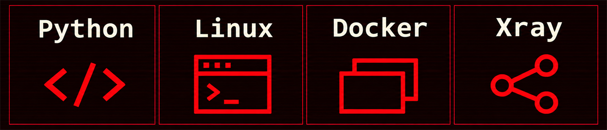

## Обо мне

Живу в России и учусь на третьем курсе по IT-направлению. Изучал C# и Python, знаком с HTML. Делаю Telegram-ботов и веб-сервисы, разворачиваю проекты на Linux и настраиваю сеть.

В программировании пока набираюсь опыта. Учусь сам и пользуюсь нейросетями, чтобы разбирать незнакомый код и искать причины ошибок. То, что узнаю, пробую на своих проектах.

## PyironVPN

> Мой VPN-сервис. В боте можно оформить подписку, а в веб-кабинете — управлять ею и устройствами.

Подключаю ноды, настраиваю маршруты и проверяю, как VPN работает в разных сетях.

[Сайт проекта](https://pyiron.top/) · [Бот](https://t.me/pyironvpnbot) · [Кабинет](https://web.pyiron.top/)

## Стек

- **Разработка** — Python, Telegram Bot API, Mini Apps.
- **Инфраструктура** — Linux, Docker Compose, Caddy.
- **Сети** — Xray, Remnawave, маршрутизация и мониторинг.

## Другие проекты

- **[pyironmod](https://t.me/pyironmod_bot)** — Telegram-бот и Mini App с каталогом команд и журналом удалённых сообщений.
- **[remnawave-proxy-script](https://github.com/localloan/remnawave-proxy-script)** — скрипты настройки Caddy и Cloudflare для Remnawave и Bedolaga.
- **[archive-autofiller](https://github.com/localloan/archive-autofiller)** — Python-скрипт для заполнения Excel-шаблона данными из текстовых файлов.

## Контакты

[Telegram](https://t.me/localloan) · [Личный сайт](https://mrlik.pyiron.top/)
